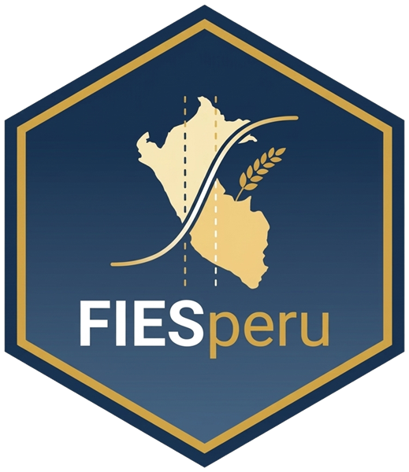

# FIESperu <a href="https://ahernandezv.github.io/FIESperu/"></a>

<!-- badges: start -->
[](https://github.com/ahernandezv/FIESperu/actions/workflows/R-CMD-check.yaml)
[](https://CRAN.R-project.org/package=FIESperu)
[](https://www.gnu.org/licenses/gpl-3.0)
<!-- badges: end -->

**`FIESperu`** automates the downloading, household-level harmonization, weighted Rasch psychometric validation, global equating, and complex-survey prevalence estimation of food insecurity in Peru from the **Food Insecurity Module (*Módulo de Inseguridad Alimentaria*, Module 2082)** of the **National Household Survey (ENAHO)** conducted by the **National Institute of Statistics and Informatics (INEI)** (2025 onwards).

It reproduces the official INEI/FAO methodology for SDG indicator 2.1.2 with exact decimal precision, including Stata-compatible population weights, linear equating to the FAO FIES global reference standard, and combined sampling (se_s) and Rasch measurement (se_m) errors.

Beyond official prevalence estimation, FIESperu also provides a reproducible, real-world data resource for teaching, training, and applied research in food insecurity measurement, FIES analysis, Rasch modeling, psychometric validation, and complex survey methodology.

---

## Installation / Instalación

```r
# From GitHub:
# install.packages("remotes")
remotes::install_github("ahernandezv/FIESperu")

# Or from R-universe (once enabled):
# install.packages("FIESperu", repos = c("https://ahernandezv.r-universe.dev", "https://cloud.r-project.org"))
```

---

## Quick Start / Uso Rápido

### 1. Replicating Official INEI ENAHO 2025 Prevalences

```r
library(FIESperu)

# Automatically downloads INEI ENAHO 2025 Stata microdata on first run,
# merges Module 2082 (FIES) + Module 34 (Sumaria) + optional sociodemographic blocks,
# and calibrates the annual weighted Rasch model:
fies_2025 <- prepare_fies(
  years = 2025,
  include = c("core", "demographics", "education_health", "programs")
)

# Estimate official FIES indicators across geographic domains:
# National Mod+Sev: 30.5% | Urban: 29.3% | Rural: 35.4% | National Severe: 3.4%
official_tbl <- estimate_fies(fies_2025, by = "official")
print(official_tbl)

# Vulnerability profiles (e.g., children < 5 years, disability, social programs):
estimate_fies(
  fies_2025,
  by = c("has_child_u5", "has_disability", "any_food_program"),
  indicator = "mod_sev"
)

# Validate the Rasch model and visualize results:
val <- validate_rasch(fies_2025)
plot_fies(val, type = "equating")
plot_fies(official_tbl, type = "prevalence", group = "region_inei")
```

### 2. Offline Demo (`fies_sample`)

```r
library(FIESperu)

df_demo <- prepare_fies(sample_data = fies_sample, quiet = TRUE)
estimate_fies(df_demo, by = c("area", "poverty"))
```

---

## Citation

If you use `FIESperu` in academic publications or technical reports, please cite:

```r
citation("FIESperu")
```

- Hernández-Vásquez, A. (2026). *FIESperu: Food Insecurity Experience Scale (FIES) Estimation for Peru*. R package version 0.1.0. <https://github.com/ahernandezv/FIESperu>
