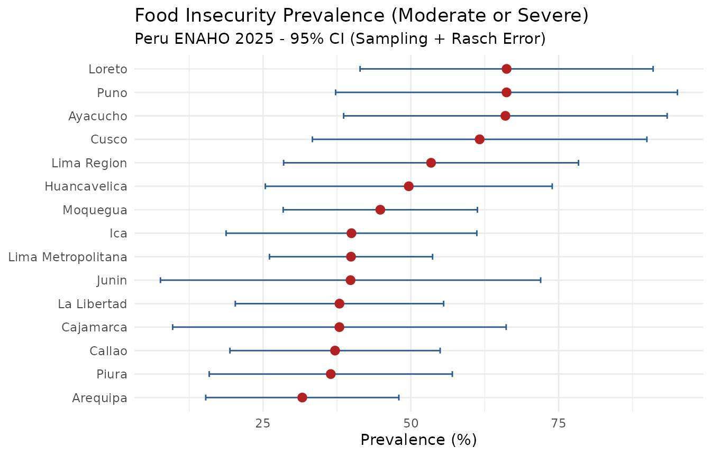
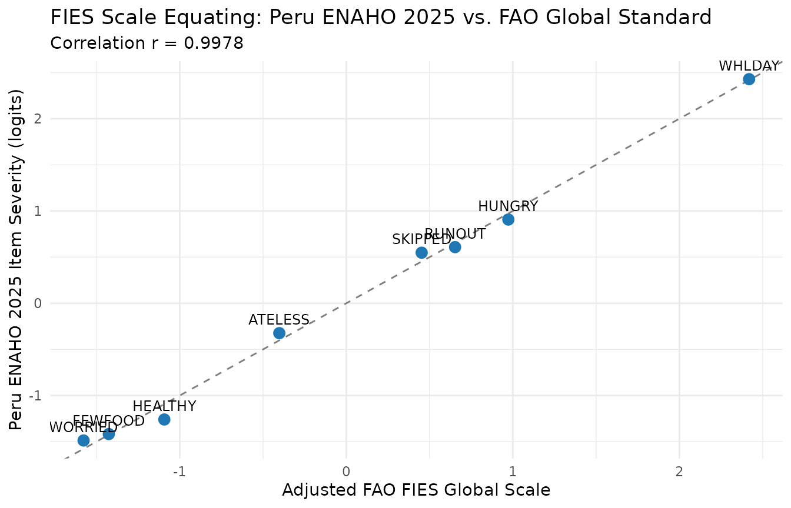

# Getting Started with FIESperu

## Overview

`FIESperu` streamlines the estimation of **Moderate or Severe** and
**Severe** food insecurity prevalence in Peru from the National
Household Survey (**ENAHO**, conducted by **INEI**) using the Food
Insecurity Experience Scale (**FIES**, Sustainable Development Goal
Indicator 2.1.2).

Specifically, `FIESperu` implements the official INEI / FAO methodology:

1.  **Automated microdata download & caching** from INEI’s `srienaho`
    repository (annual surveys from 2025 onwards).
2.  **Modular household harmonization** linking Module 2082
    (`enaho01-{year}-130`, FIES) and Module 34 (`sumaria-{year}-12g`)
    with optional housing/NBI (`"housing"`), household demographic
    composition (`"demographics"`), education/disability/insurance
    (`"education_health"`), and social protection programs
    (`"programs"`).
3.  **Weighted Rasch calibration & global equating** against the FAO
    FIES global reference scale (`fies.global.st`), including 32-bit
    Stata float population weight matching
    ([`as_stata_float()`](https://ahernandezv.github.io/FIESperu/reference/as_stata_float.md)).
4.  **Combined variance estimation** combining Taylor-linearized
    complex-survey sampling error (`se_s`) and Rasch latent measurement
    error (`se_m`).

``` r

library(FIESperu)
```

## 1. Exploring Available ENAHO Modules

Use
[`fies_modules()`](https://ahernandezv.github.io/FIESperu/reference/fies_modules.md)
to inspect the modular data blocks supported by the package:

``` r

fies_modules()
#> # A tibble: 7 × 6
#>   block           inei_module module_name_es dta_pattern unit_raw available_from
#>   <chr>           <chr>       <chr>          <chr>       <chr>             <int>
#> 1 core            2082        Inseguridad A… enaho01-{y… Househo…           2025
#> 2 core            34          Sumarias (Var… sumaria-{y… Househo…           2025
#> 3 housing         01          Caracteristic… enaho01-{y… Househo…           2025
#> 4 demographics    02          Caracteristic… enaho01-{y… Member …           2025
#> 5 education_heal… 03          Educacion      enaho01a-{… Member …           2025
#> 6 education_heal… 04          Salud y Disca… enaho01a-{… Member …           2025
#> 7 programs        37          Programas Soc… enaho01-{y… Househo…           2025
```

## 2. Preparing Household Microdata and Fitting the Rasch Model

With an internet connection, running
`prepare_fies(years = 2025, include = "all")` automatically downloads
and caches all required ENAHO 2025 Stata files on first use and returns
a clean household-level `tibble`:

``` r

# Real ENAHO 2025 workflow (downloads once and reuses local cache):
df_2025 <- prepare_fies(
  years = 2025,
  include = c("core", "demographics", "education_health", "programs")
)
```

For offline illustration, we use the bundled synthetic stratified
dataset `fies_sample`:

``` r

df_demo <- prepare_fies(sample_data = fies_sample, quiet = TRUE)
df_demo[, c("year", "area", "region_inei", "poverty", "fies_rs", "pr_mod_sev", "pr_sev")]
#> # A tibble: 400 × 7
#>     year area  region_inei        poverty  fies_rs pr_mod_sev     pr_sev
#>    <int> <fct> <chr>              <fct>      <int>      <dbl>      <dbl>
#>  1  2025 Rural Cusco              Non-Poor       1     0.0335 0.00000723
#>  2  2025 Urban Ica                Poor           3     0.349  0.0000872 
#>  3  2025 Urban Ica                Non-Poor       1     0.0335 0.00000723
#>  4  2025 Rural Ayacucho           Poor           7     0.993  0.539     
#>  5  2025 Urban Piura              Non-Poor       0     0.0271 0.0000704 
#>  6  2025 Urban Callao             Non-Poor       2     0.115  0.00000784
#>  7  2025 Rural Cajamarca          Poor           1     0.0335 0.00000723
#>  8  2025 Rural Cusco              Non-Poor       5     0.892  0.0194    
#>  9  2025 Urban Lima Metropolitana Non-Poor       6     0.975  0.151     
#> 10  2025 Rural Huancavelica       Non-Poor       2     0.115  0.00000784
#> # ℹ 390 more rows
```

Because
[`prepare_fies()`](https://ahernandezv.github.io/FIESperu/reference/prepare_fies.md)
returns a household-level `tibble` containing `conglome`, `estrato`,
`wt_hh`, `wt_pop`, and `pr_mod_sev`, you can also pass it directly to
[`survey::svydesign()`](https://rdrr.io/pkg/survey/man/svydesign.html)
and [`survey::svyglm()`](https://rdrr.io/pkg/survey/man/svyglm.html) for
multivariable regression analyses.

## 3. Psychometric Validation (`validate_rasch`)

Inspect item severities, `infit`/`outfit` statistics, flat Rasch
reliability, and correlation against the FAO global standard:

``` r

val <- validate_rasch(df_demo)
val
#> == FIESperu Psychometric Rasch Validation ==
#> 
#> -- Scale Summary --
#> # A tibble: 1 × 13
#>    year n_total n_complete n_partial_na n_all_na reliab_fl reliab cor_global
#> * <int>   <int>      <int>        <int>    <int>     <dbl>  <dbl>      <dbl>
#> 1  2025     400        400            0        0     0.732  0.686      0.998
#> # ℹ 5 more variables: sd_b <dbl>, thresh_mod_sev <dbl>, thresh_sev <dbl>,
#> #   max_infit <dbl>, eigenvalue_1 <dbl>
#> 
#> -- Item Severity & Fit Statistics --
#> # A tibble: 8 × 11
#>    year item_num enaho_var item_code severity_b  se_b infit outfit global_st
#> * <int>    <int> <chr>     <chr>          <dbl> <dbl> <dbl>  <dbl>     <dbl>
#> 1  2025        1 p130_1    WORRIED       -1.49  0.133 0.883  0.789    -1.22 
#> 2  2025        2 p130_2    HEALTHY       -1.26  0.130 0.985  0.915    -0.847
#> 3  2025        3 p130_3    FEWFOOD       -1.42  0.132 1.07   1.07     -1.11 
#> 4  2025        4 p130_4    SKIPPED        0.548 0.138 1.02   1.06      0.351
#> 5  2025        5 p130_5    ATELESS       -0.324 0.127 0.935  0.844    -0.312
#> 6  2025        6 p130_6    RUNOUT         0.608 0.139 1.09   1.17      0.507
#> 7  2025        7 p130_7    HUNGRY         0.907 0.146 1.10   1.05      0.755
#> 8  2025        8 p130_8    WHLDAY         2.43  0.214 0.949  0.964     1.88 
#> # ℹ 2 more variables: adj_global_st <dbl>, diff_from_global <dbl>
```

## 4. Estimating Prevalences and Margins of Error (`estimate_fies`)

Compute national estimates, custom subgroup breakdowns (including
Cartesian interactions), or the full official INEI geographical
breakdown (`by = "official"`, which separates *Lima Metropolitana* from
*Lima Region*):

``` r

# National prevalence
estimate_fies(df_demo)
#> # A tibble: 2 × 13
#>    year group category indicator estimate lower upper   moe se_total  se_s  se_m
#>   <int> <chr> <chr>    <chr>        <dbl> <dbl> <dbl> <dbl>    <dbl> <dbl> <dbl>
#> 1  2025 Nati… National Moderate…    44.9  39.6  50.3   5.35     2.73 2.13  1.71 
#> 2  2025 Nati… National Severe        5.72  3.15  8.28  2.57     1.31 0.980 0.868
#> # ℹ 2 more variables: cv <dbl>, n_unweighted <int>

# Disaggregation by urban/rural area and monetary poverty (with interaction)
estimate_fies(
  df_demo,
  by = c("area", "poverty"),
  combine_by = TRUE,
  indicator = "mod_sev"
)
#> # A tibble: 9 × 13
#>    year group category indicator estimate lower upper   moe se_total  se_s  se_m
#>   <int> <chr> <chr>    <chr>        <dbl> <dbl> <dbl> <dbl>    <dbl> <dbl> <dbl>
#> 1  2025 Nati… National Moderate…     44.9  39.6  50.3  5.35     2.73  2.13  1.71
#> 2  2025 area  Urban    Moderate…     38.8  32.4  45.3  6.42     3.28  2.65  1.93
#> 3  2025 area  Rural    Moderate…     55.9  46.3  65.6  9.68     4.94  3.54  3.45
#> 4  2025 pove… Poor     Moderate…     49.3  38.4  60.2 10.9      5.55  4.49  3.26
#> 5  2025 pove… Non-Poor Moderate…     43.4  37.2  49.7  6.24     3.18  2.47  2.01
#> 6  2025 area… Rural x… Moderate…     53.5  41.8  65.1 11.6      5.94  4.07  4.33
#> 7  2025 area… Rural x… Moderate…     60.9  44.6  77.2 16.3      8.33  6.03  5.75
#> 8  2025 area… Urban x… Moderate…     38.7  31.3  46.1  7.41     3.78  3.04  2.24
#> 9  2025 area… Urban x… Moderate…     39.5  25.5  53.5 14.0      7.15  6.04  3.83
#> # ℹ 2 more variables: cv <dbl>, n_unweighted <int>
```

## 5. Visualizing Results (`plot_fies`)

``` r

est_reg <- estimate_fies(df_demo, by = "region_inei", indicator = "mod_sev")
plot_fies(est_reg, type = "prevalence")
#> `height` was translated to `width`.
```



``` r

plot_fies(val, type = "equating")
```


