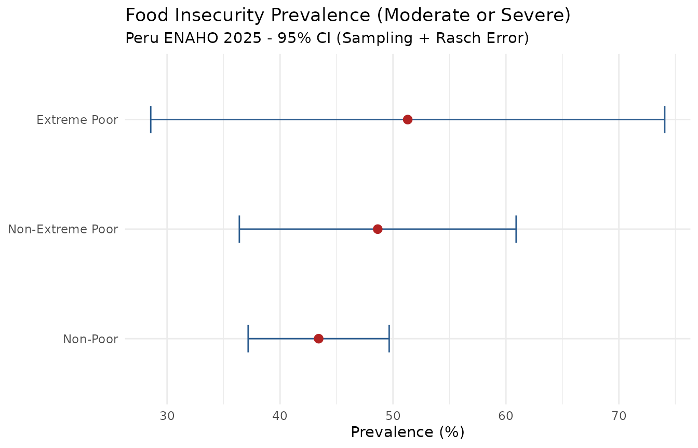
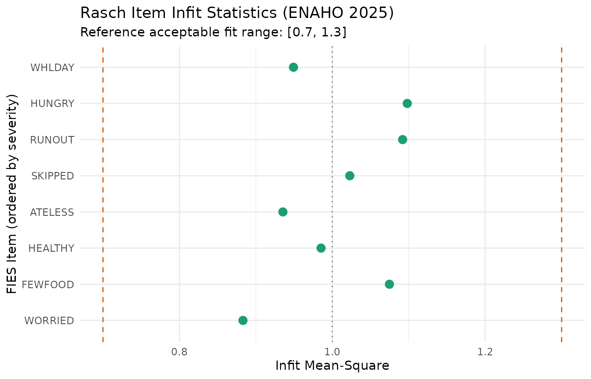

# Guía en Español: Estimación de Inseguridad Alimentaria con FIESperu

## Introducción

El paquete `FIESperu` automatiza la descarga, armonización, validación
psicométrica (Modelo de Rasch) y estimación poblacional de la
**Inseguridad Alimentaria Moderada o Severa** y **Severa** en el Perú a
partir del **Módulo de Inseguridad Alimentaria** de la **Encuesta
Nacional de Hogares (ENAHO)** del **INEI** (desde 2025 en adelante),
replicando exactamente la metodología oficial del INEI y la FAO
(Indicador ODS 2.1.2).

``` r

library(FIESperu)
```

## 1. Bloques Modulares Disponibles

A partir de 2025, el INEI incorporó de manera permanente el **Módulo de
Inseguridad Alimentaria** (`Modulo 2082` en `srienaho`, archivo
`enaho01-2025-130`, Capítulo 130). Con
[`fies_modules()`](https://ahernandezv.github.io/FIESperu/reference/fies_modules.md)
puedes consultar todos los módulos de la ENAHO que `FIESperu` puede
descargar y cruzar a nivel de hogar:

``` r

fies_modules()
#> # A tibble: 7 × 6
#>   block           inei_module module_name_es dta_pattern unit_raw available_from
#>   <chr>           <chr>       <chr>          <chr>       <chr>             <int>
#> 1 core            2082        Inseguridad A… enaho01-{y… Househo…           2025
#> 2 core            34          Sumarias (Var… sumaria-{y… Househo…           2025
#> 3 housing         01          Caracteristic… enaho01-{y… Househo…           2025
#> 4 demographics    02          Caracteristic… enaho01-{y… Member …           2025
#> 5 education_heal… 03          Educacion      enaho01a-{… Member …           2025
#> 6 education_heal… 04          Salud y Disca… enaho01a-{… Member …           2025
#> 7 programs        37          Programas Soc… enaho01-{y… Househo…           2025
```

- `"core"`: Módulo 2082 (8 preguntas FIES) + Módulo 34 (`sumaria`,
  pobreza monetaria, gasto e ingreso per cápita, miembros del hogar
  `mieperho`) y variables geográficas oficiales (`area`, `department`,
  `region_inei` separando **Lima Metropolitana** y **Lima Región**, y
  `natural_region`).
- `"housing"`: Módulo 01 (agua por red pública, cloro residual seguro,
  alcantarillado, electricidad, combustible limpio para cocinar, piso de
  tierra y Necesidades Básicas Insatisfechas `nbi_1`..`nbi_5`).
- `"demographics"`: Módulo 02 agregado a hogar (presencia de menores de
  5 años `has_child_u5`, menores de 18, adultos mayores de 60+, y sexo,
  edad y estado civil del jefe o jefa de hogar).
- `"education_health"`: Módulos 03 y 04 agregados a hogar (nivel
  educativo y lengua materna indígena o castellano del jefe de hogar,
  presencia de alguna persona con discapacidad permanente
  `has_disability` y seguro de salud SIS/EsSalud).
- `"programs"`: Módulo 37 (acceso del hogar a Vaso de Leche, Comedor
  Popular, Alimentación Escolar, Cuna Más, Juntos, Pensión 65, Contigo y
  Bono Gas).

## 2. Flujo con Microdatos Reales de ENAHO (2025+)

Cuando trabajas conectado a internet,
[`prepare_fies()`](https://ahernandezv.github.io/FIESperu/reference/prepare_fies.md)
descarga por única vez los archivos `.dta` oficiales del INEI en tu
caché local
([`fies_cache_dir()`](https://ahernandezv.github.io/FIESperu/reference/fies_cache_dir.md))
y construye la base consolidada de hogares:

``` r

# Descarga (si no está en caché) y prepara ENAHO 2025 con todos los módulos:
datos_2025 <- prepare_fies(years = 2025, include = "all")

# Replicación exacta del informe técnico oficial del INEI 2025:
# Nacional Moderada o Severa: 30.5% | Urbana: 29.3% | Rural: 35.4% | Severa: 3.4%
tabla_oficial <- estimate_fies(datos_2025, by = "official")
```

Si ya descargaste manualmente los archivos `.dta` o `.sav` en una
carpeta local (por ejemplo, `"D:/Inseguridad_Alimentaria_2025"`), puedes
indicarla con `local_dir`:

``` r

datos_locales <- prepare_fies(
  years = 2025,
  local_dir = "D:/Inseguridad_Alimentaria_2025",
  download = FALSE
)
```

## 3. Ejemplo Reproducible Sin Conexión (`fies_sample`)

Usando la muestra sintética incluida en el paquete (`fies_sample`):

``` r

base_hogar <- prepare_fies(sample_data = fies_sample, quiet = TRUE)

# Validación psicométrica del modelo de Rasch (severidad, infit, outfit, confiabilidad)
val_rasch <- validate_rasch(base_hogar)
val_rasch$summary
#> # A tibble: 1 × 13
#>    year n_total n_complete n_partial_na n_all_na reliab_fl reliab cor_global
#> * <int>   <int>      <int>        <int>    <int>     <dbl>  <dbl>      <dbl>
#> 1  2025     400        400            0        0     0.732  0.686      0.998
#> # ℹ 5 more variables: sd_b <dbl>, thresh_mod_sev <dbl>, thresh_sev <dbl>,
#> #   max_infit <dbl>, eigenvalue_1 <dbl>
val_rasch$items[, c("item_code", "severity_b", "infit", "adj_global_st")]
#> # A tibble: 8 × 4
#>   item_code severity_b infit adj_global_st
#>   <chr>          <dbl> <dbl>         <dbl>
#> 1 WORRIED       -1.49  0.883        -1.58 
#> 2 HEALTHY       -1.26  0.985        -1.09 
#> 3 FEWFOOD       -1.42  1.07         -1.43 
#> 4 SKIPPED        0.548 1.02          0.453
#> 5 ATELESS       -0.324 0.935        -0.402
#> 6 RUNOUT         0.608 1.09          0.653
#> 7 HUNGRY         0.907 1.10          0.973
#> 8 WHLDAY         2.43  0.949         2.42
```

### Estimación de prevalencias con error muestral + error de medición

[`estimate_fies()`](https://ahernandezv.github.io/FIESperu/reference/estimate_fies.md)
combina el error estándar del diseño muestral complejo (`conglome`,
`estrato`, `wt_pop`) con el error de medición de Rasch:

``` r

# Prevalencia según presencia de menores de 5 años y discapacidad
estimate_fies(
  base_hogar,
  by = c("has_child_u5", "has_disability"),
  indicator = "mod_sev"
)
#> # A tibble: 5 × 13
#>    year group category indicator estimate lower upper   moe se_total  se_s  se_m
#>   <int> <chr> <chr>    <chr>        <dbl> <dbl> <dbl> <dbl>    <dbl> <dbl> <dbl>
#> 1  2025 Nati… National Moderate…     44.9  39.6  50.3  5.35     2.73  2.13  1.71
#> 2  2025 has_… 0        Moderate…     45.3  38.9  51.8  6.40     3.27  2.62  1.96
#> 3  2025 has_… 1        Moderate…     43.7  33.5  53.9 10.2      5.21  3.82  3.55
#> 4  2025 has_… 0        Moderate…     45.5  39.7  51.2  5.75     2.93  2.28  1.84
#> 5  2025 has_… 1        Moderate…     41.7  27.0  56.3 14.7      7.48  5.79  4.75
#> # ℹ 2 more variables: cv <dbl>, n_unweighted <int>
```

### Gráficos de prevalencia y diagnóstico Rasch

``` r

res_area <- estimate_fies(base_hogar, by = "poverty_3cat", indicator = "mod_sev")
plot_fies(res_area, type = "prevalence")
#> `height` was translated to `width`.
```



``` r

plot_fies(val_rasch, type = "items")
```


